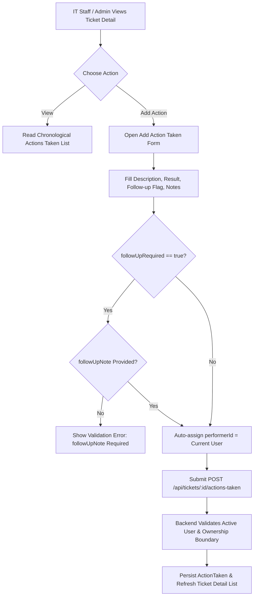
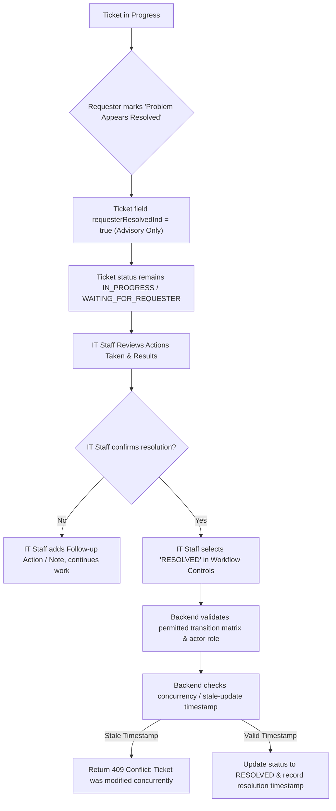
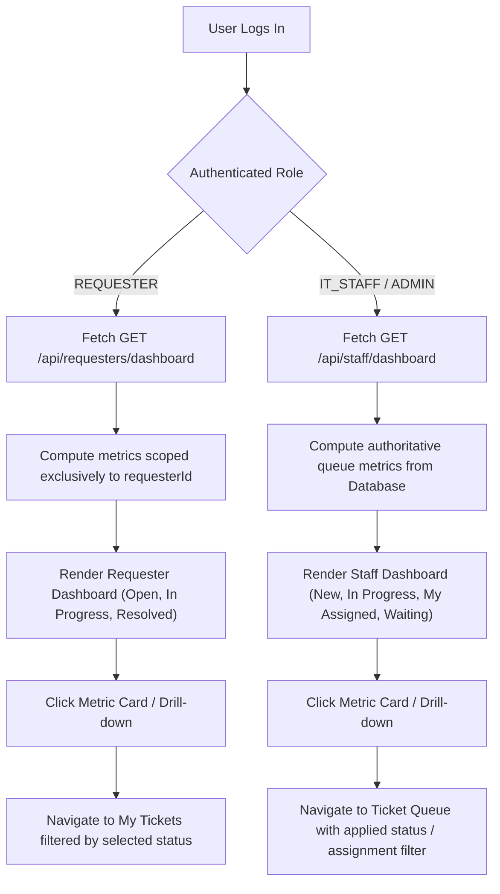
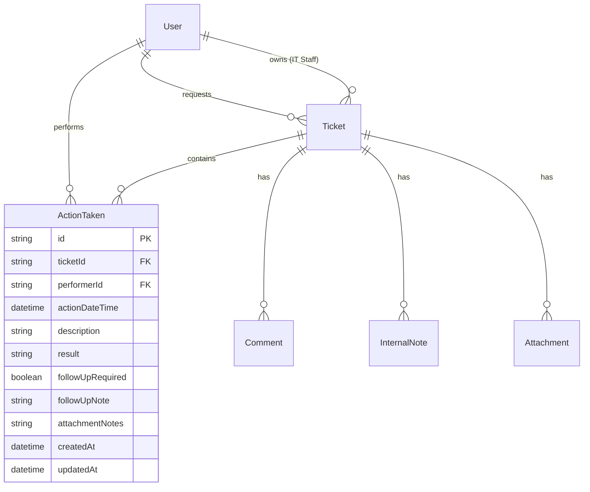

# Lab 4 Sprint Engineering Specification

## 1. Sprint Goal
Complete the core TokTickIT service-desk application by implementing a parent-child Actions Taken work structure for IT Staff, enforcing strict Ticket status lifecycle rules and formal resolution gates, providing authoritative, role-appropriate dashboards for Requesters, IT Staff, and Administrators, and hardening the entire application with complete regression preservation from Labs 1 through 3 under the Zen Green design language.

---

## 2. Stakeholder Request Interpretation
"The service desk can now receive Tickets and IT Staff can communicate with Requesters, but we still need a reliable way to plan and track the actual work. Add Actions Taken under each Ticket. Each action should contain Action Date/Time, Action Description, Result, Performed by (auto), Follow-Up Required?, Follow-up Note (required when follow-up is needed), Attachment Notes (what file to look for images etc.).

The primary Ticket Owner remains responsible for coordinating the Ticket as a whole. Requesters may continue to indicate that the problem appears resolved, but IT Staff must review the work and formally update the Ticket.

Add useful dashboards for Requesters and IT Staff, but keep them concise and connected to the detailed screens. Finally, polish and harden the complete application so that all earlier features continue to work consistently under the Zen Green design language."

---

## 3. Workflow Diagrams

### 3.1 Parent-Child Actions Taken Workflow

### 3.2 Ticket Status Transition & Resolution Gate Workflow

### 3.3 Role Dashboards & Authoritative Drill-Down Workflow

---

## 4. Scope

### 4.1 Included Scope
- **Parent-Child Actions Taken:** Model, schema, APIs, and UI to create, edit, view, and track actions taken under a ticket.
- **Action Fields:** Action Date/Time, Description, Result, Performed by (auto-populated with authenticated user), Follow-Up Required flag, Follow-Up Note (strictly required if follow-up flag is true), and Attachment Notes.
- **Role Permissions for Actions Taken:** IT Staff and Administrators have full create and update rights on accessible tickets; Requesters have read-only visibility on their owned tickets.
- **Ownership vs. Performer Decoupling:** Primary Ticket Owner oversees the ticket; distinct IT Staff members can perform individual Actions Taken.
- **Ticket Status Lifecycle & Transition Matrix:** Strict backend transition enforcement across `NEW`, `OPEN`, `IN_PROGRESS`, `WAITING_FOR_REQUESTER`, `RESOLVED`, `CLOSED`, `REOPENED`, and `CANCELLED`.
- **Formal Resolution Gate:** Requester resolution feedback is strictly advisory; only IT Staff or Administrators can formally resolve or close a ticket.
- **Concurrency & Safe Failure:** Optimistic locking/timestamp check on status transitions and Actions Taken to reject conflicting stale updates with HTTP 409 Conflict.
- **Requester Dashboard:** Authoritative summary of authenticated Requester's tickets (Total Open, In Progress, Resolved, Closed, Recent Tickets) with drill-down links.
- **IT Staff Dashboard:** Operational command center showing queue metrics (New, Open, In Progress, Waiting for Requester, My Assigned, Unassigned), recent tickets, and drill-down actions.
- **Administrator Dashboard:** IT Staff dashboard capabilities augmented with user-account summary metrics.
- **Database Evolution & Idempotent Seeding:** Prisma migration preserving legacy data and seed data containing tickets with 0, 1, and multiple Actions Taken.
- **Zen Green Polish & Regression:** Full regression preservation of Labs 1 through 3, responsive layout (Desktop, Tablet, Mobile), and accessibility compliance.

### 4.2 Explicitly Excluded Scope (Handout Section 4.2)
- Automatic SLA clocks, escalation engines, on-call scheduling, and breach notifications.
- Email, SMS, LINE, push, or external notification services.
- Inventory consumption, spare-parts management, purchasing, or service cost accounting.
- Time-sheet billing, payroll, or detailed labor-cost calculations.
- Multi-level approval workflows and electronic signatures.
- Advanced business-intelligence tools, custom report builders, or export data warehouses.
- Multi-tenant organizations and production-scale cloud operations.
- New unapproved product features not defined in this engineering contract.

---

## 5. Functional Requirements (FR)

- **FR-01 (Actions Taken Recording):** The system shall allow authenticated IT Staff and Administrators to record new Actions Taken under any accessible ticket.
- **FR-02 (Automatic Performer Attribution):** The system shall automatically assign the authenticated user's ID and name to the `performedBy` field upon creating an Action Taken.
- **FR-03 (Follow-up Validation):** The system shall require a non-empty `followUpNote` whenever `followUpRequired` is set to `true`.
- **FR-04 (Requester Read-Only Visibility):** The system shall allow Requesters to view all Actions Taken on tickets they own, but shall strictly prohibit Requesters from creating, modifying, or deleting Actions Taken (HTTP 403 Forbidden).
- **FR-05 (Multi-Staff Collaboration):** The system shall allow any active IT Staff member to record an Action Taken on a ticket regardless of who the primary Ticket Owner is.
- **FR-06 (Actions Taken Listing & Editing):** The system shall return Actions Taken in reverse-chronological order (newest first) and allow editing by authorized staff.
- **FR-07 (Permitted Status Transitions):** The system shall enforce permitted ticket transitions strictly at the backend API layer.
- **FR-08 (Resolution Gate Enforcement):** The system shall treat Requester resolution indications as advisory (`requesterResolvedInd = true`), requiring explicit IT Staff or Administrator action to transition status to `RESOLVED`.
- **FR-09 (Concurrency Stale-Update Protection):** The system shall detect stale ticket modifications via `updatedAt` / version matching and reject outdated requests with HTTP 409 Conflict.
- **FR-10 (Requester Dashboard Metrics):** The system shall provide an authoritative endpoint (`GET /api/requesters/dashboard`) returning count metrics strictly filtered to the authenticated Requester's owned tickets.
- **FR-11 (IT Staff Dashboard Metrics):** The system shall provide an authoritative endpoint (`GET /api/staff/dashboard`) returning queue summary metrics (New, Open, In Progress, Waiting for Requester, My Assigned, Unassigned) and recent tickets.
- **FR-12 (Dashboard Drill-Down Navigation):** The user interface shall provide accessible links from each metric card to the corresponding filtered ticket list with exact matching counts.
- **FR-13 (Inactive User Protection):** The system shall reject assigning Actions Taken or tickets to inactive user accounts.
- **FR-14 (Safe Error & Loading States):** The system shall render accessible loading indicators, empty states, and descriptive error banners across all dashboard and detail components.
- **FR-15 (Regression Preservation):** The system shall preserve all previously built features from Labs 1–3 including Authentication, Public Comments, Internal Notes, Attachments, and User Management.

---

## 6. Business Rules (BR)

| BR ID | Business Rule Statement | Enforcement Layer |
| :--- | :--- | :--- |
| **BR-01** | An Action Taken belongs to exactly one parent Ticket (`ticketId` foreign key is mandatory and immutable). | Database & Backend API |
| **BR-02** | The Ticket Owner coordinates the Ticket, but an Action Taken may be performed and recorded by any active IT Staff or Administrator. | Backend API & UI |
| **BR-03** | An Action Taken record must include: Action Date/Time (defaults to now), Description (min 5 chars), Result (min 2 chars), Performed by (auto-assigned from auth token), Follow-Up Required (boolean), Follow-Up Note (mandatory if Follow-Up Required is true), and Attachment Notes (optional string). | Backend Validation & Client Form |
| **BR-04** | Requesters have read-only visibility into Actions Taken for tickets they own. Write attempts by Requesters must be rejected with HTTP 403 Forbidden. | Backend Middleware |
| **BR-05** | An Action Taken cannot be attributed to or updated by an inactive user account. Inactive users must be rejected with HTTP 400 Bad Request. | Backend API |
| **BR-06** | Permitted Ticket Status Transitions:  • `NEW` → `OPEN`, `IN_PROGRESS`, `CANCELLED` • `OPEN` → `IN_PROGRESS`, `WAITING_FOR_REQUESTER`, `CANCELLED` • `IN_PROGRESS` → `WAITING_FOR_REQUESTER`, `RESOLVED`, `CANCELLED` • `WAITING_FOR_REQUESTER` → `IN_PROGRESS`, `RESOLVED`, `CANCELLED` • `RESOLVED` → `CLOSED`, `REOPENED` • `CLOSED` → (Terminal, or `REOPENED` by Admin) • `CANCELLED` → (Terminal) | Backend Workflow Controller |
| **BR-07** | A Requester setting "Problem Appears Resolved" does not transition the ticket to `RESOLVED`. Formal resolution requires an active IT Staff or Administrator role. | Backend Workflow Controller |
| **BR-08** | Stale Update Handling: Every ticket workflow update and action update must submit the client's current `updatedAt` timestamp. If database `updatedAt` is newer, the request must fail with HTTP 409 Conflict. | Backend Service Layer |
| **BR-09** | Requester Dashboard calculations must query only tickets where `requesterId == authenticatedUser.id`. | Backend Dashboard Service |
| **BR-10** | IT Staff Dashboard calculations must be computed in real-time from the database across active operational queues without hardcoded values. | Backend Dashboard Service |
| **BR-11** | Empty Dashboard Behavior: When a metric count is 0, the card must display `0` (not null or NaN), and clicking it shall open the queue displaying an appropriate empty-state message. | UI Component Layer |
| **BR-12** | Auditability: Deleted tickets or users must not orphan Actions Taken; Actions Taken history must be retained with full referential integrity. | Database Foreign Key Rules |

---

## 7. Database Design & Migration Decisions

### 7.1 Entity Relationship Diagram

### 7.2 Justification of Database Design Decisions
1. **Decision 1: Normalized `ActionTaken` Child Table with Compound Indexing**
   - *Rationale:* Placing actions in a dedicated `ActionTaken` table with foreign keys `ticketId` (referencing `Ticket`) and `performerId` (referencing `User`) enforces relational integrity. An index on `(ticketId, actionDateTime DESC)` guarantees high-performance retrieval when rendering Ticket Detail screens with extensive action histories.
2. **Decision 2: Optimistic Locking via `updatedAt` Timestamps for Stale-Update Prevention**
   - *Rationale:* Service desk environments involve concurrent access where multiple staff or requesters may view the same ticket. Using `updatedAt` comparison during status transitions and action additions prevents race conditions and overwriting concurrent changes without requiring heavy pessimistic table locks.
3. **Decision 3: Backward-Compatible Non-Destructive Migration & Idempotent Seeding**
   - *Rationale:* Legacy tickets from Labs 1–3 must remain fully valid without actions (`tickets with 0 actions`). The Prisma migration introduces the new table without modifying existing table columns, ensuring zero data loss during sprint rollout.

---

## 8. Observable Acceptance Criteria (AC)

- **AC-01:** Given an authenticated IT Staff user, when submitting valid Action Taken data for a ticket, then the record is created with `performedById` set to the authenticated user and returned with HTTP 201 Created.
- **AC-02:** Given an IT Staff user submitting an Action Taken with `followUpRequired: true` and an empty `followUpNote`, then the request is rejected with HTTP 400 Bad Request and a clear field validation message.
- **AC-03:** Given an authenticated Requester, when attempting to `POST` or `PATCH` an Action Taken, then the server rejects the request with HTTP 403 Forbidden.
- **AC-04:** Given an authenticated Requester viewing their owned ticket, then all associated Actions Taken are visible in read-only mode without action modification buttons.
- **AC-05:** Given an authenticated IT Staff user who is NOT the primary Ticket Owner, when they create an Action Taken on an accessible ticket, then the action is successfully created under their name while the Ticket Owner remains unchanged.
- **AC-06:** Given a ticket in `OPEN` status, when an unauthorized status transition is requested (e.g., `OPEN` directly to `CLOSED`), then the request is rejected with HTTP 400 Bad Request.
- **AC-07:** Given a ticket where `requesterResolvedInd: true`, when inspected by IT Staff, the advisory notice is displayed, and the ticket status remains non-resolved until formally updated by IT Staff.
- **AC-08:** Given a client submitting a ticket status update with a stale `updatedAt` timestamp, then the server responds with HTTP 409 Conflict.
- **AC-09:** Given an authenticated Requester, `GET /api/requesters/dashboard` returns exact metrics matching only their owned tickets, and metric card clicks navigate to `/my-tickets?status=...`.
- **AC-10:** Given an authenticated IT Staff user, `GET /api/staff/dashboard` returns correct aggregate counts for `New`, `Open`, `In Progress`, `Waiting for Requester`, and `My Assigned`, with drill-down links to `/staff/tickets?status=...`.
- **AC-11:** Given an inactive IT Staff user, attempting to perform an Action Taken or receive ticket assignment fails with HTTP 400 Bad Request.
- **AC-12:** All regression tests from Labs 1–3 (Authentication, Public Comments, Internal Notes, Attachments, User Management) execute and pass with 100% success rate.

---

## 9. Product Definition of Done (DoD)

- [ ] All Sprint 4 specifications (`specification.md`, `api-spec.md`, `ui-spec.md`) and test plans (`tests.md`) are documented and peer-reviewed.
- [ ] Prisma schema is updated with `ActionTaken` model and migration runs cleanly without loss of Lab 1–3 data.
- [ ] Idempotent seed script generates realistic tickets with 0, 1, and multiple Actions Taken, plus active/inactive users.
- [ ] All REST endpoints for Actions Taken, Requester Dashboard, and IT Staff Dashboard are implemented and secured.
- [ ] Status transition matrix and resolution gate rules are enforced at backend API layer.
- [ ] Client UI provides IT Staff Dashboard, Requester Dashboard, and Ticket Detail Actions Taken section following the Zen Green theme.
- [ ] Concurrency conflict handling (409 Conflict) is implemented and user receives safe-failure feedback.
- [ ] All automated Unit, API, UI, Regression, and E2E tests pass completely.
- [ ] Responsive design verified on Mobile (375px), Tablet (768px), and Desktop (1280px).
- [ ] Feature branches merged into `lab4-staging` via peer-reviewed PRs, with final merge into `main`.
